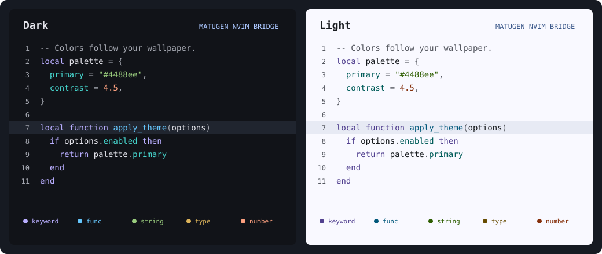

# matugen-nvim-bridge

A complete Neovim colorscheme that follows your Matugen palette, with readable
syntax colors and automatic reload.

[](https://github.com/Lauritz-Timm/matugen-nvim-bridge/actions/workflows/ci.yml)
[](LICENSE)



The preview uses the plugin's generated colors in both modes.

- Themes the editor, menus, selections, search, diagnostics, diffs and terminal colors.
- Gives functions, strings, numbers, types and keywords distinct hues.
- Keeps Vim syntax, Treesitter captures and LSP semantic tokens consistent.
- Corrects text contrast across nine editor and UI backgrounds on every generation.
- Updates open editors when Matugen writes or replaces the palette file.

No other colorscheme plugin, editor server or reload hook is needed. The runtime
uses only Neovim's built-in APIs.

## Requirements

- Neovim **0.10.4 or newer**, with a true-color terminal or GUI.
- Matugen **4.x** for the supplied template, or a compatible JSON file.
  The integration suite uses Matugen 4.2.0.

## Quick start

### 1. Configure Matugen

Copy [`templates/palette.json`](templates/palette.json) to
`~/.config/matugen/templates/nvim-colors.json`.

Add this to your Matugen configuration, or update the existing Neovim entry:

```toml
[templates.neovim]
input_path = "~/.config/matugen/templates/nvim-colors.json"
output_path = "~/.cache/matugen/nvim-colors.json"
```

Generate your palette:

```sh
matugen --mode dark image /path/to/wallpaper.jpg
```

Use `--mode light` for a light palette. The plugin follows the generated mode.

### 2. Install in Neovim

With [lazy.nvim](https://github.com/folke/lazy.nvim):

```lua
{
  "Lauritz-Timm/matugen-nvim-bridge",
  main = "matugen_nvim_bridge",
  lazy = false,
  priority = 1000,
  opts = {
    palette_path = "~/.cache/matugen/nvim-colors.json",
  },
}
```

`setup()` selects the colorscheme and starts watching the palette directory.
You do not need a second colorscheme declaration.

For another plugin manager, install the repository on your runtimepath and call:

```lua
require("matugen_nvim_bridge").setup({
  palette_path = "~/.cache/matugen/nvim-colors.json",
})
```

### 3. Change your wallpaper

Run Matugen as usual. Once it writes the JSON file, open Neovim instances update
automatically. Both ordinary writes and atomic file replacements are supported.
The plugin does not run Matugen or change the wallpaper itself.

## Configuration

`palette_path` is required. Every other setting is optional:

```lua
require("matugen_nvim_bridge").setup({
  palette_path = "~/.cache/matugen/nvim-colors.json",
  watch = true,
  transparent = false,
  contrast = 4.5,
  colors = {
    -- Optional syntax colors; lightness is corrected when needed.
    func = "#80baff",
    number = "#efa164",
  },
})
```

| Option | Default | Purpose |
| --- | --- | --- |
| `palette_path` | Required | Matugen JSON file; `~` is expanded. |
| `watch` | `true` | Reload automatically after file changes, with a short debounce. |
| `transparent` | `false` | Inherit the terminal background for editor content and floats. |
| `contrast` | `4.5` | Minimum text contrast ratio across the checked theme backgrounds. |
| `colors` | `{}` | Override the starting colors for individual syntax roles. |

Supported syntax roles: `foreground`, `comment`, `punctuation`, `keyword`,
`func`, `string`, `type`, `number`, `constant` and `property`.

Overrides preserve their hue where possible. Their lightness and, when necessary,
chroma are adjusted to meet the requested contrast and fit within sRGB.

### Contrast

Every syntax role is checked against the editor surface, cursorline, three UI
surfaces and four diff backgrounds. The accent and error text colors are checked
against the same backgrounds. Search and selection text are checked against
their respective backgrounds.

The default target is **4.5:1**. You can request a higher value, such as `7`.
If the requested ratio cannot be met across the supplied backgrounds, generation
is rejected and the last working theme remains in place. Decorative borders and
whitespace markers intentionally use subtler colors.

With `transparent = true`, the visible background also depends on your terminal
and wallpaper. The calculated ratios cannot guarantee contrast over that
composited background.

### Plugin highlights

Highlight definitions are included for Telescope, Neo-tree, blink.cmp and
Gitsigns. These integrations do not require or load those plugins. Other plugins
can use Neovim's standard highlight groups.

## Commands and API

| Command | Purpose |
| --- | --- |
| `:MatugenNvimBridgeReload` | Read the palette again and activate the theme. |
| `:colorscheme matugen-nvim-bridge` | Select the colorscheme after setup. |
| `:checkhealth matugen_nvim_bridge` | Check configuration, input, contrast and file watching. |
| `:help matugen-nvim-bridge` | Open the bundled documentation. |

Choosing a different colorscheme suspends automatic updates. Select
`matugen-nvim-bridge` again to resume them. Set `watch = false` for manual reloads only.

```lua
local bridge = require("matugen_nvim_bridge")

bridge.reload()                   -- palette, or nil and an error
bridge.generate(matugen_json)     -- calculate a palette without changing Neovim
bridge.status()                   -- configuration and watcher state
local palette = bridge.current   -- most recently applied palette, initially nil
```

`generate(data, options)` returns
`{ colors, contrast, background, backgrounds, mode, ui }`.
Each `contrast` value is that syntax role's lowest ratio across `backgrounds`.
Invalid input raises an error in `generate()`; file reloads catch the error,
notify once per reload attempt and preserve the existing highlights.

Successful reloads emit Neovim's `ColorScheme` event so integrations can refresh.

## Input formats

The included template produces a flat object. Only four fields are required:

```json
{
  "surface": "#101510",
  "on_surface": "#e1e6dd",
  "primary": "#95d5a7",
  "outline": "#8b9388"
}
```

The full template also exports `surface_container_low`, `surface_container`,
`surface_container_high`, `primary_container`, `outline_variant` and `error`.
Those values shape the UI; omitted values are derived from the required colors.
The flat aliases `surface_low` and `surface_high` are also accepted.

Matugen 4's native `--json hex` output is supported through its
`colors.<role>.default.color` fields. The `default` values reflect the mode chosen
during Matugen generation.

You may write a compatible JSON file by hand. Values must be `#RRGGBB` strings.
Lua/Vim colorscheme files and Base16-only exports are not input formats.

## Troubleshooting

**Nothing updates after Matugen runs.** Check that `palette_path` matches the
template's `output_path`, the parent directory exists, and this colorscheme is
selected. Run `:checkhealth matugen_nvim_bridge` and try `:MatugenNvimBridgeReload`.

**The JSON is missing or temporarily incomplete.** Existing highlights remain
visible. If watching started successfully, the next valid write is applied
automatically. Generate the file and create its parent directory before starting
Neovim; rerun `setup()` if the directory was missing when watching began.

**Changing `background` does not produce a different palette.** The JSON is the
source of truth. Run Matugen with the desired `--mode`; the plugin selects the
matching Neovim background mode.

**The terminal is transparent but Neovim is opaque.** Set
`transparent = true`. Terminal opacity and compositor blur remain terminal and
window-manager settings.

## Development

```sh
make test                  # self-contained Neovim suite
make test-matugen          # real Matugen exports and live reload; requires Python 3.10+
python3 tests/matugen.py --preview  # also regenerate the palette preview
```

CI runs the core suite on the minimum supported Neovim and stable Neovim, plus a
real Matugen integration suite. See [CONTRIBUTING.md](CONTRIBUTING.md).

Repository administration and protection rules are documented in
[the maintainer guide](.github/MAINTAINING.md).

Color conversion uses the public-domain
[Oklab matrices](https://bottosson.github.io/posts/oklab/). The plugin is available
under the [MIT license](LICENSE).
